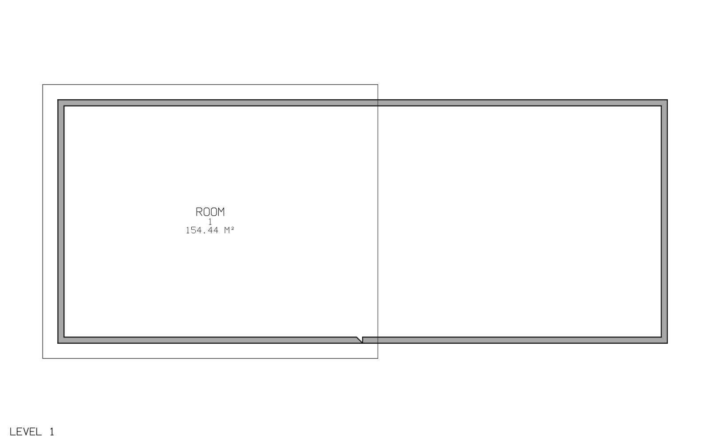

# Raised wall preserves the room below: issue #312

Reproduction base: upstream `30527e323e9c2e59abff927e4b76fe3ce0f83e15` / official Windows portable 0.11.0. Fixed-source evidence comes from branch `fix/raised-wall-room-enclosure`.

Run `bimcraft-cli run --script repro.txt`. The unmodified release reports **154.44 m2 / enclosed** before the raised wall and **0 m2 / not enclosed** afterward; see `repro-before.log`. Finish-face area also changes incorrectly from 148.96 to 148.98 m2 (`repro-finish-before.log`).

`red-current.log` captures three failing command regressions and one passing control before the fix. `green-current.log` captures all four passing after the fix. These tests also exercise move/delete/undo/redo, Room Bounding, computation-height changes and fresh native reads.

Run the fixed CLI with `bimcraft-cli run --script journey.txt --save room-after.ifc`. `journey-after.log` records the enclosed room and schedule after adding the raised wall. Run `bimcraft-cli run --script reopen.txt` to verify native persistence; `reopen.log` retains the room GUID and reports 154.44 m2 at centre lines and 148.96 m2 at finish faces.

`room-after.ifc` is independently checked with IfcOpenShell 0.8.5. `ifc-validation.log` records **12 products, 8 shapes built, 0 problems**, including EXPRESS validation. `python verify_ifc_rooms.py room-after.ifc` checks one IfcSpace with GrossFloorArea **154.44 m2**, NetFloorArea **148.96 m2**, and a nonempty **10-vertex / 16-face** room mesh; see `ifc-room-quantities.log`.

Cargo regression runs used local-only overrides `--config profile.dev.package.bimcraft-core.opt-level=0 --config profile.dev.debug=0`. These profile settings are not part of the fix. Broader test results are reported separately with the linked fix PR.
