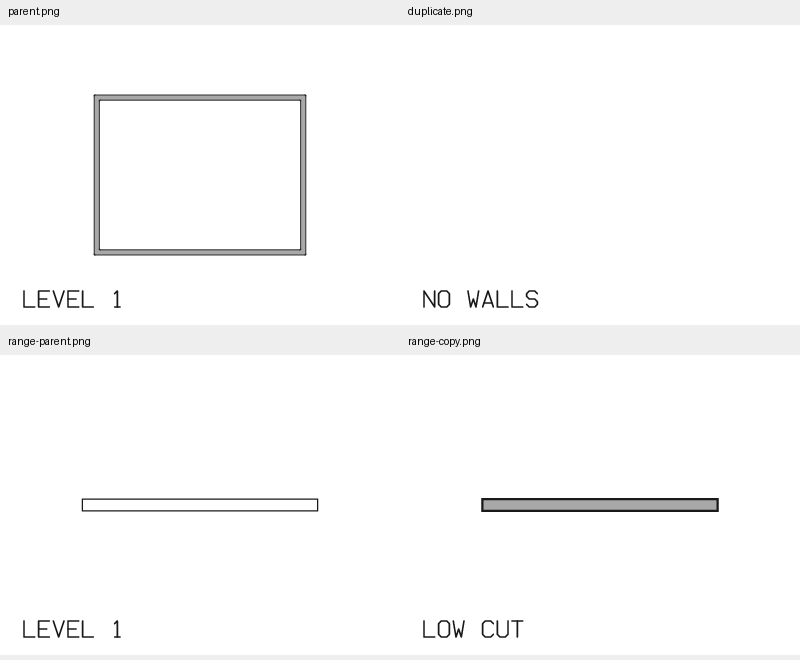
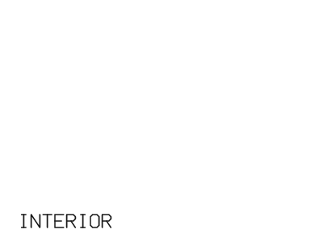

# Rendering a selected duplicated plan: issue #313

Reproduction base: upstream `30527e323e9c2e59abff927e4b76fe3ce0f83e15` (0.11.0). Fixed source: `c0997c822556ac172e048b2a61630d9f2a5da47c`, branch `fix/duplicated-plan-render`. Tested on Windows 11.

`red.log` captures the three new command-driven PNG regressions failing before the fix, with one passing linked-model control. `green.log` captures all four passing after the fix. Tests select duplicated plans by name, numeric id and GUID, and cover graphics, crop, view range, correct reply names and unchanged parent output.

`verify_cli.py` invokes the source-built CLI as subprocesses and tests actual PNG output. Run `python verify_cli.py <bimcraft-cli-executable> <output-directory>`. `graphics.txt`, `crop.txt` and `range.txt` are the generated synthetic commands; `cli-verification.log` and `summary.json` contain the observed results:

| Output | Cut-wall pixels above the title |
| --- | ---: |
| Parent, before and after rendering the duplicate | 2176 |
| Duplicate with walls hidden, by name and id | 0 |
| Interior-only crop | 0 |
| Unchanged parent of cropped duplicate | 2176 |
| 900 mm wall in ordinary parent plan | 0 |
| Same wall in duplicate with a 500 mm cut | 1856 |

The driver also checks selected view names and byte-identical parent PNGs before/after. It prints `All CLI journeys passed.`. The montage and crop below were visually inspected.

Local test/build runs used uncommitted overrides `--config profile.dev.package.bimcraft-core.opt-level=0 --config profile.dev.debug=0`. The CLI was built with `--no-default-features`, excluding unrelated DWG/Revit readers. These settings are not part of the fix. A broader core run ended without a final summary and is not claimed passing; full workspace and platform CI remain separately reported with the fix PR.
