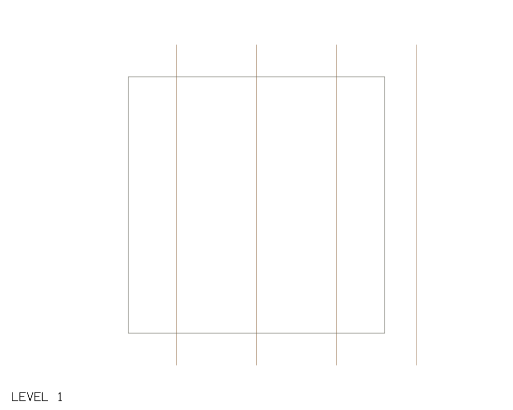
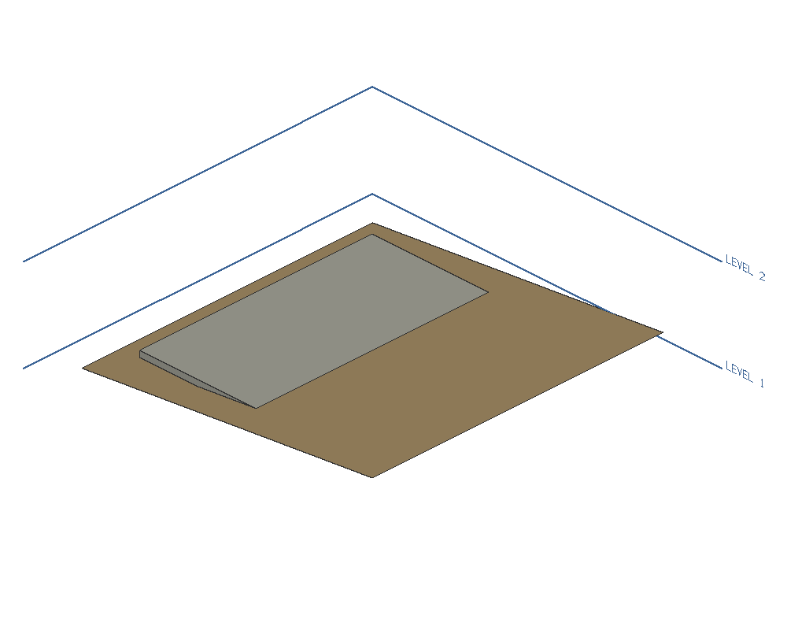

# Terrain acceptance evidence

Synthetic terrain only. Acceptance base: [PR 289](https://github.com/IPedrax/BIMCraft/pull/289) at `5f666a84a45f6f71bf7dd399eb2e0edfe752be40`. [Tracker evidence](https://github.com/IPedrax/BIMCraft/pull/289#issuecomment-6741305038).

The fixture is a 10 m square rising from 0 to 1 m eastward, with a survey breakline across its centre. An 8 m square pad has top elevation 0.5 m and thickness 0.2 m. Expected cut and fill are each 6.4 m³ (two 4 m × 8 m triangular prisms, maximum depth 0.4 m). Pad volume is 12.8 m³.

## Reproduce

Build this contribution's CLI with `cargo build -p bimcraft-cli --no-default-features`. This excludes optional DWG/RVT readers, which the terrain journey does not use.

Run `python run_acceptance.py /path/to/bimcraft-cli`. It creates the synthetic survey, queries heights and cut/fill, schedules the pad, saves/reopens native and IFC models, and renders both views. Every command is in [survey.txt](survey.txt); measured responses are in [cli-results.json](cli-results.json).

With IfcOpenShell 0.8.5 and pytest installed, run `python validate_terrain_ifc.py`. The independent [IFC results](independent-ifc-results.json) report zero schema/EXPRESS errors, 12 unique GlobalIds, both physical shapes built, terrain bounds (0,0,0)..(10,10,1) m and area 100.4987562112089 m², and pad bounds (1,1,0.3)..(9,9,0.5) m and volume 12.8 m³.

## Inspected output

The 3D pad intersects the original ground. Pads calculate earthworks; they do not grade the terrain mesh, as the parent feature documents.

## Scope and limits

The repository's `terrain_acceptance` integration target also covers a skew quadrilateral with a forced valley diagonal through native save/reopen, invalid pad rollback, GUID retention, and a synthetic pre-site format-17 fixture with an unknown annotation field. The older fixture is not an archived project or evidence of a private-model migration.

IFC acceptance here covers the planar survey and pad. Native breaklines survive; IFC import is documented to rebuild from vertices without retaining constraints/boundaries. This package does not claim constrained-surface IFC round-trip fidelity, coordinate-system acceptance, desktop interaction, live DEM/network fetching, or full workspace/platform CI.

Local development builds used `profile.dev.package.bimcraft-core.opt-level=0`, `profile.dev.debug=0`, two Cargo jobs, `RAYON_NUM_THREADS=2` and at most four test threads. See [verification summary](verification-summary.txt) for the exact scoped results.

Actual captured and sanitized outputs: [final tests and agent docs](command-output/acceptance-final.txt), [terrain tests](command-output/topo-tests.txt), [pad tests](command-output/pad-tests.txt), [CLI](command-output/cli-acceptance.txt), [independent IFC](command-output/independent-ifc.txt), [clippy](command-output/clippy.txt), [formatting](command-output/fmt-check.txt), [i18n update](command-output/i18n-update.txt), [i18n check](command-output/i18n-check.txt), and [catalogue preservation](command-output/catalog-preservation.txt). The [initial test precision failure](command-output/acceptance-initial.txt) is retained for transparency; it was not a product defect.

## Review correction: a breakline that changes the surface

The original valley fixture was cocircular: its unconstrained triangulation already gave the three queried heights as zero. It could not detect a lost breakline. The [old-fixture control failure](command-output/round1-old-fixture-control.txt) demonstrates this test weakness, not a product defect.

The corrected synthetic vertices are `(0,0,0)`, `(10000,0,2000)`, `(10000,10000,0)` and `(0,8000,2000)` mm. At `(2500,2500)`, `(5000,5000)` and `(7500,7500)`, the unconstrained planes give **1125, 1800 and 900 mm**. The test asserts those calculated heights before adding the zero-height diagonal breakline from `(0,0,0)` to `(10000,10000,0)` in a separate session. The constrained samples must be **0, 0 and 0 mm**, both before save and after opening the native file in a fresh session.

[Corrected acceptance and documentation checks](command-output/round1-acceptance-green.txt): 4 + 3 passed. [Focused clippy](command-output/round1-clippy.txt), [formatting](command-output/round1-fmt.txt), [i18n update](command-output/round1-i18n-update.txt) and [i18n check](command-output/round1-i18n-check.txt) passed. [Preservation check](command-output/round1-preservation.txt) confirms unchanged catalogue content and original synthetic native/IFC/PNG bytes. The previous 29 terrain/9 pad tests and CLI/independent IFC evidence were not rerun for this tests/documentation-only correction.

The documentation now states the **current** file format 18 without asserting when terrain or pads were introduced.
Review correction commit: `7ebeb79fa917a840d3b90b9548977909bd3b77c5` over `0d176e8700b80f98a5241534cad297b56a6284c7`.
